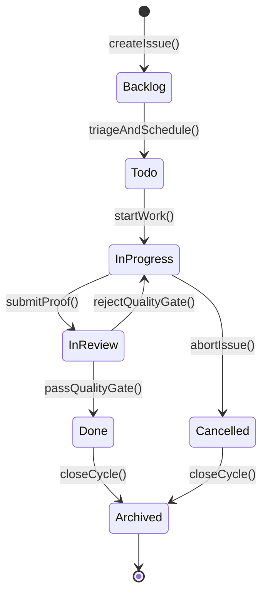
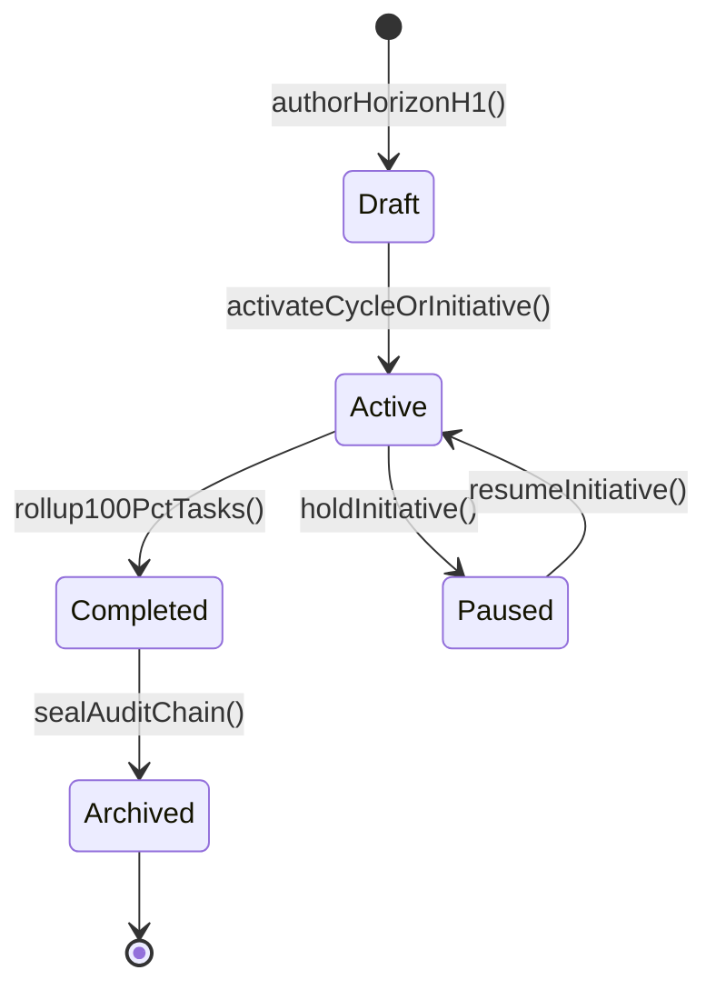
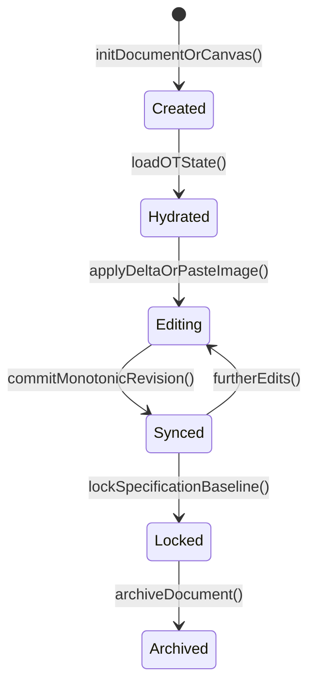
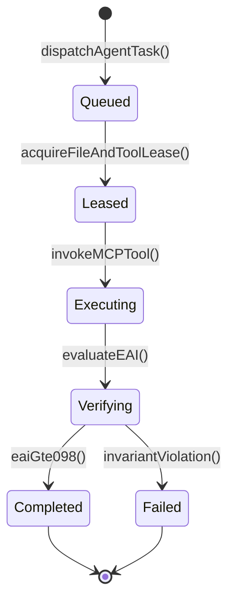
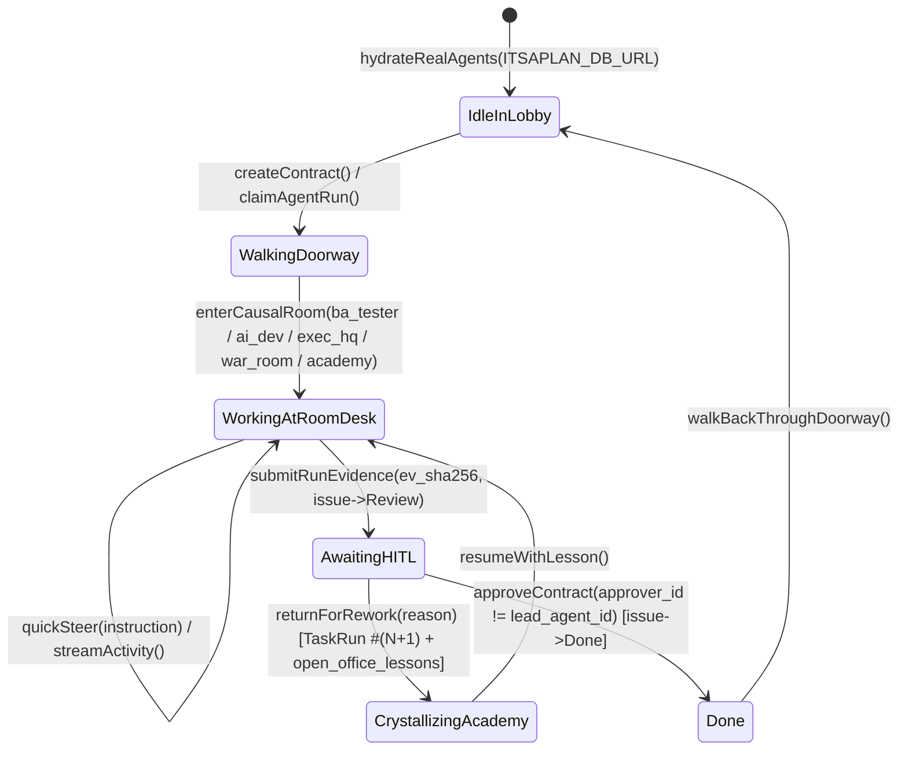
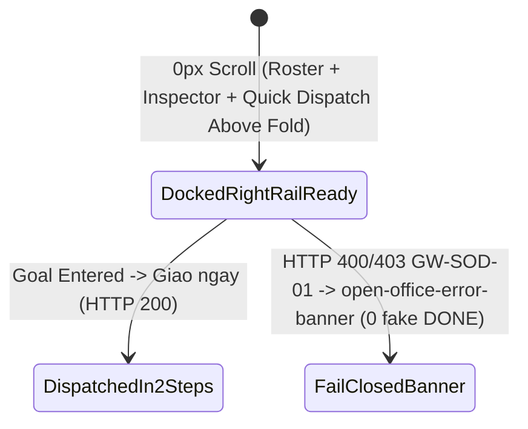

# ItsAPlan Compulsory Entity & Document Lifecycle State Diagrams (`state_diagrams.md`)

- **identifier**: `[CANARY:AGENTS.md:GOVERNED]`
- **version**: `3.3.0`

## 1. Issue & Subtask WBS Lifecycle (`UC-002`, `UC-008`)

## 2. Initiative & Cycle Lifecycle (`UC-005`, `SPEC-ITSAPLAN-284`)

## 3. Vibe Working Canvas & Project Document Lifecycle (`UC-006`, `UC-007`)

## 4. Autonomous Agent Run Lifecycle (`UC-003`)

## 5. Open Office Task Contract, 1:N TaskRun & Causal Room Navigation Lifecycle (`UC-010 v2.0`, `53.ACT.500`)

<!-- UTOP_53_ACT_505_HARNESS_V320_ZERO_DUP_JTBD -->
## State Machine SM-010B: Non-Overlapping Split-Shell & Fail-Closed SoD Banner (`SPEC-53.ACT.505`)

